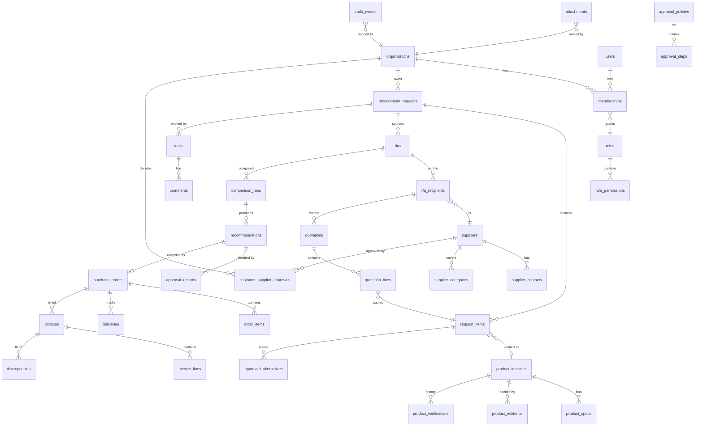
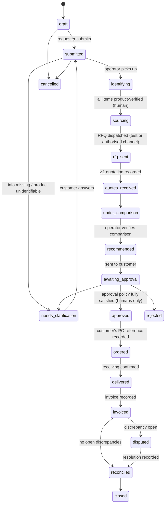

# Architecture proposal — Chuo-Sogo AI Industrial Procurement Platform

Status: **APPROVED** (founder, 2026-10-31: "don't wait for my approval"). Phase 1 implemented; see `IMPLEMENTATION_PLAN.md`.

## 1. Starting point

Greenfield. No procurement code exists anywhere on the server (searched `/` to depth 4). So there is nothing to migrate or preserve. The Chuo-Sogo website and prospecting repos are unrelated and stay untouched.

## 2. Business model the architecture encodes (Model C)

Software + managed procurement operations. Chuo-Sogo **coordinates**; the customer **decides and pays**.

- No inventory, no resale, no payments, no financing, no autonomous purchasing.
- A purchase order is a *record of the customer's decision*, created only after the customer's approval policy is satisfied.
- Future resale is possible later as a separate bounded module (`commerce`); nothing in v1 assumes it.

## 3. Shape: Rust-first modular monolith + Tauri desktop client

```
┌──────────────────────── Desktop client (Tauri 2) ────────────────────────┐
│  React + TypeScript UI (presentation only, i18next: ja/en/ta/hi/…)       │
│        │  invoke() — narrow, typed IPC commands                          │
│  Rust native layer: API client (rustls), OS keychain token store,        │
│  local prefs/cache (non-authoritative), notifications, signed updater    │
└────────────────────────────────┬─────────────────────────────────────────┘
                                 │ HTTPS + bearer session token
┌────────────────────────────────▼─────────────────────────────────────────┐
│  procure-server (one Rust binary: Axum + Tower + Tokio)                  │
│  ├ auth / orgs / rbac        ├ rfq            ├ orders                   │
│  ├ requests                  ├ quotations     ├ invoices                 │
│  ├ products (identity)       ├ comparison     ├ ops (tasks, SLA)         │
│  ├ suppliers                 ├ approvals      ├ reports, audit           │
│  ├ ai (orchestration, schemas, provenance) — calls provider adapters     │
│  └ jobs worker (same binary, `--worker`): Postgres SKIP LOCKED queue     │
├──────────────────────────────────────────────────────────────────────────┤
│  PostgreSQL 18 (authoritative; RLS on tenant tables)                     │
│  Object storage trait: local FS (dev) → S3-compatible (prod)             │
│  AI providers trait: Mock (tests) │ local LLM │ remote API (opt-in)       │
└──────────────────────────────────────────────────────────────────────────┘
```

### Workspace layout

| Path | Language | Owns |
|---|---|---|
| `crates/domain` | Rust | Pure rules: money, units, state machines, comparison maths, approval limits, compliance checks. No I/O. |
| `crates/server` | Rust | Axum API, SQLx repositories (tenant-scoped), auth, jobs, audit, OpenAPI (utoipa). |
| `crates/ai` | Rust | Provider trait, mock provider, JSON-schema validation of model output, prompt templates that fence untrusted text. |
| `crates/storage` | Rust | Object-store trait, upload validation (size, magic bytes, type allowlist), malware-scan hook. |
| `migrations/` | SQL | Versioned SQLx migrations, RLS policies. |
| `apps/desktop/src-tauri` | Rust | Native shell, IPC commands, keychain, updater. |
| `apps/desktop/src` | TypeScript | UI only. Typed client generated from OpenAPI. |
| `apps/desktop/locales/<lang>/*.json` | JSON | UI strings. |
| `scripts/` | Shell | Gate, dev DB, packaging. |

### Programming-language decisions

- **Rust**: everything authoritative (brief §5 overrides the earlier "Python backend" option).
- **TypeScript**: presentation only. No financial or permission logic.
- **SQL**: schema, constraints, RLS, reporting views.
- **Shell**: automation.
- **Python**: none in v1. Revisit only if a document-extraction library has no adequate Rust option (ADR required).
- **C/C++**: none in v1. Only after a Rust benchmark shows a real limit (ADR required). Likely first candidate: OCR via Tesseract (C++) behind a narrow FFI, or run it out-of-process.

## 4. Key design decisions

| # | Decision | Why |
|---|---|---|
| D1 | Modular monolith, one binary + worker mode | One deployable for a small team; module boundaries enforced by crate/module visibility. |
| D2 | Server-side opaque sessions (hashed token in `sessions`), argon2id passwords | Revocable, simple, no JWT key handling on clients. SSO (OIDC/SAML) added later as another login method. |
| D3 | Tenant isolation in two layers: every repository function takes `TenantCtx`, **and** PostgreSQL RLS keyed on `SET LOCAL app.org_id` | Defence in depth: a missed `WHERE org_id` still returns nothing. |
| D4 | All internal staff (admins included) access customer data only through `service_assignments` (org-scoped grant); grants/revocations audited in both orgs. Accounts are permanently `internal` or `customer` (DB-enforced), and every membership starts as an invitation the user accepts | Least privilege; no cross-tenant profile exposure; staff can never hold customer approval roles. |
| D5 | Money = `i64` minor units + ISO currency; FX only via recorded `fx_rates` (source, date); no implicit conversion | Deterministic, auditable comparisons. |
| D6 | AI writes only to `ai_suggestions` (pending). A human action promotes it into `product_identities`, `quotations`, etc. | AI can never be the final authority (brief §10). |
| D7 | Workflow states are Rust enums + DB `CHECK`; transitions only via `domain::workflow` functions that also emit an audit event in the same transaction | No silent status changes. |
| D8 | Audit log append-only (`audit_events`, no UPDATE/DELETE grant, hash-chained per org) | Tamper evidence. |
| D9 | Supplier comms: `outbox` table; dispatch is `test` mode by default (writes `.eml` files); real SMTP needs explicit config + per-org enablement | No accidental real emails. |
| D10 | Desktop keeps the session token in Rust process memory only (not in the webview, not on disk); all API calls go through validated Rust IPC. OS-keychain "stay signed in" deferred | Token theft via webview XSS impossible; nothing to steal from disk. Keychain needs a Secret Service on Linux and is a convenience, not a requirement. |
| D11 | OpenAPI generated from Rust (utoipa) → TS types (openapi-typescript); contract test fails if the spec changes without regeneration | No type drift across languages. |
| D12 | Postgres-backed job queue | No Redis to operate. Enough until thousands of jobs/min. |
| D13 | Localisation: canonical codes in DB (`status = 'awaiting_approval'`), labels only in locale files; DB text is UTF-8; timestamps `timestamptz`, displayed in user TZ (default Asia/Tokyo) | Language never changes data. |

## 5. Data model (v1)

All tenant-owned tables carry `org_id uuid NOT NULL REFERENCES organisations` with RLS. IDs are UUIDv7. Human-readable numbers (`PR-2026-000123`) are per-org sequences.



Other tables: `sessions`, `password_resets`, `permissions`, `service_assignments` (operator ↔ org), `communications` + `outbox`, `notifications`, `service_activity` (time tracking), `fx_rates`, `ai_suggestions` (with provider, model, prompt hash, input refs, confidence), `jobs`.

`suppliers` is a **platform-level** directory (Chuo-Sogo's supplier intelligence). What is tenant-specific (customer approval, prices quoted to that customer, notes) lives in org-scoped tables. A customer never sees another customer's quotations from the same supplier.

## 6. Core workflow (state machine)



Product identity: `extracted (AI) → pending_review → verified | needs_clarification | rejected`. Supplier: `discovered → contacted → under_review → verified → (per org) customer_approved | rejected`, `inactive`. Quotation compliance: `compliant | non_compliant | needs_review | incomplete` (computed by deterministic checks, overridable only by a human with a recorded reason).

## 7. Minimum viable release (MVR)

Exactly the brief's §16 list, in this scope:

1. Desktop app (Linux build verified here; Win/macOS via CI) with login, org switcher, ja/en (ta/hi strings present).
2. Org + users + 7 roles + approval policy (amount thresholds, multi-step, no self-approval by default).
3. Request with items, attachments (local storage), status tracking.
4. Product identity records with evidence, human verification, alternatives needing customer approval. AI extraction via **mock** provider + one optional local provider.
5. Supplier directory with statuses; RFQ creation; dispatch in **test mode** (file export) + manual response entry.
6. Quotation entry, deterministic normalisation (same-currency or recorded FX), compliance checks, comparison view with reasons.
7. Recommendation → customer approval → audit trail.
8. Manual PO reference + order/delivery status.
9. Manual invoice entry + 3-way match (PO / quote / invoice) with discrepancy records.
10. Ops console: queue, assignment, priority, due dates, internal notes, time records.
11. Basic reports (turnaround, response rate, discrepancies).
12. Passing tenant-isolation, permission and workflow suites.

Out of MVR: SSO, real email sending, invoice OCR, supplier web discovery, live logistics, auto-update server, Chinese/Korean full translation.

## 8. Real vs mocked in v1

| Area | v1 |
|---|---|
| Auth, RBAC, tenancy, workflow, money, comparison, approvals, audit | Real |
| PostgreSQL, migrations, RLS | Real |
| File storage | Real local FS; S3 adapter later |
| AI extraction / matching / summarising | Mock provider in tests; local model adapter optional; remote API adapter only with founder-approved key |
| Supplier email | Test mode (files) only |
| Malware scan | Hook + ClamAV adapter if installed; otherwise uploads quarantined as "unscanned" |
| Logistics tracking | Manual |
| Payments | Never |
| Installers | Linux real (built + smoke-tested here); Windows/macOS via GitHub Actions, unverified until run on those OSes |

## 9. Risks

| Risk | Mitigation |
|---|---|
| Cross-tenant leak (operators span orgs) | D3 + D4, dedicated isolation test suite on every gate |
| AI hallucinated part numbers / substitutions | D6; exact MPN match is deterministic; alternatives need customer approval record |
| Prompt injection in supplier docs | Untrusted text fenced, AI has no tools that write; output schema-validated; injected "approve" text is inert data |
| FX/tax errors | Integer money, explicit FX records, JP consumption tax rules in `domain::tax` with tests |
| Desktop on headless server | Linux builds + Xvfb/WebKitWebDriver tests here; other OSes via CI |
| Code-signing cost/custody | Unsigned dev builds; signing is a founder decision |
| Scope (11 modules) vs one builder | Phased plan, gate per milestone, MVR first |
| RAM (31 GB, ~9 GB free with other services) | Single binary, no extra infra containers in dev; Postgres already running |
