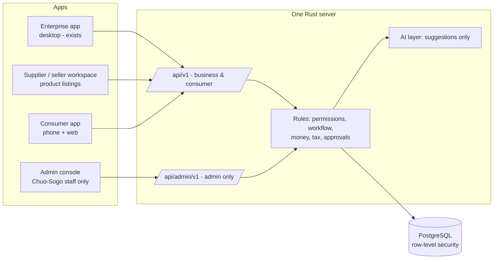

# Expansion plan — admin console, invoice generation, product listings with AI, consumer side

Status (2026-11-01): founder accepted the defaults. **Phases A (admin console), B (invoice
generation), C (supplier workspace + catalogue) and D (AI listing assistance: text, voice,
files, translation; photo reading pending [D5]) implemented and tested** — see
`docs/engineering/gates/phaseA.md` … `phaseD.md`; phases E–F not started. Decisions marked
**[D#]** use the recommended defaults unless the founder says otherwise.

## 1. What the founder asked for

1. A **separate app for Chuo-Sogo system administrators** that controls the whole platform
   (users, companies, rules, monitoring) and does **invoice generation**.
2. Two customer sides: **enterprises (businesses)** — today's app — and **consumers**.
3. Everything meets at **one central endpoint**; the admin side maintains the rules.
4. **Product listings by companies**: 2–3 high-quality photos, model number, description,
   specifications — and AI help so they do not have to type it all:
   - speak a description (**voice narration**) → clean text and fields,
   - read the **photos** (nameplate/label) → model number, brand,
   - read **files/catalogues** (PDF, Excel) → fields.

## 2. Architecture: one system, several apps

- **One server, one database, one set of rules.** Apps are only windows onto it; no app can
  bypass a rule because the rules live on the server (as today).
- **Separate apps per audience**, not one app with hidden screens: simpler screens per
  user, and the admin console can be locked down without affecting customers.
- **One identity system, typed accounts.** Today accounts are `internal` or `customer`. Extend
  to `internal` (Chuo-Sogo), `business` (enterprise buyers — today's `customer`),
  `supplier` (companies listing products) and `consumer` (individuals). An account's type
  never changes (as today, enforced in the database).
- **Each app only accepts its own account types.** Sessions record which app they were
  issued for ("audience"); every API route group checks it. A consumer session can never call
  business or admin routes, even with a modified app.
- **Admin routes are a separate namespace** (`/api/admin/v1`), served only to the admin app,
  with stronger controls (section 3).

## 3. Admin console (new app, Chuo-Sogo staff only)

Built on the existing platform roles (super admin, procurement admin, operator), which already
have the right permissions in the server; the console is their dedicated, hardened app.

| Module | Contents |
|---|---|
| Organisations & accounts | Create/suspend companies, consumers, suppliers; members, roles; staff assignments (exists in API) |
| Rules | Approval-policy defaults, service levels (today fixed 24 h → configurable), tax settings, allowed suppliers, AI provider on/off per customer |
| Catalogue moderation | Review supplier product listings before they are published (section 5) |
| Invoice generation | Invoices Chuo-Sogo issues (section 4) |
| Monitoring | Audit-log viewer and chain verification (exists in API), operations queue (exists), AI usage and failures, system health |
| Reports | Volumes, savings, service levels, invoices issued/paid |

Security (stronger than customer apps):
- Two-step login (TOTP authenticator app) required for every admin account.
- Access only from Chuo-Sogo's network/VPN (IP allow-list on the admin routes).
- Shorter sessions (30 min idle), re-authentication for dangerous actions (suspending an org,
  issuing/voiding invoices, changing tax settings).
- Every admin action audited in the platform audit log (as today).
- Distributed only to staff machines; never published in an app store.

## 4. Invoice generation (invoices Chuo-Sogo issues)

Today the platform **checks** supplier invoices (three-way match). New: Chuo-Sogo **issues**
invoices — e.g. the managed-procurement service fee to business customers and, for the
consumer side, sales invoices/receipts.

Japanese qualified invoice (適格請求書, インボイス制度) — required contents to implement:
1. Issuer name and **registration number** (T + 13 digits) **[D1]**.
2. Transaction date; description of goods/services, marking reduced-rate (8%) items.
3. Totals **per tax rate** (10% / 8%) and the **tax per rate**, rounded once per rate per
   invoice (the rounding logic already exists in `procure_domain::matching::tax`).
4. Recipient name.

Implementation:
- Sequential, gap-free invoice numbers per issuer and year; issued invoices are immutable.
- Corrections only by **credit note** (返還インボイス) or a corrected invoice that references the
  original — never by editing.
- PDF generated on the server (Rust), stored content-addressed like attachments, hash in the
  audit log. Optional later: e-invoice exchange (JP PINT / Peppol).
- Retention: electronic records kept to the Japanese electronic bookkeeping requirements
  (電子帳簿保存法) — the exact retention and search requirements must be confirmed with the
  company's accountant **[D2]**.
- Payment status tracking (issued → paid / overdue); actual payment collection is a separate
  decision (section 6).

## 5. Product listings by companies, with AI help

### 5.1 Listing data
| Field | Notes |
|---|---|
| Photos | 2–5 images, at least 1200 px on the long side, JPEG/PNG/WebP, checked by content (reuses attachment storage); first photo is the cover |
| Manufacturer, model / part number | Required; checked against duplicates in the catalogue |
| Serial number | Only for individual units (used/refurbished/one-off). For normal catalogue products the model number is the identifier **[D3]** |
| Title, description | Japanese first; English optional; AI can draft the other language |
| Specifications | Key/value list (dimensions, material, voltage, …) |
| Documents | Datasheets, manuals, certificates (PDF) |
| Price & stock | Separate business price and consumer price (tax-inclusive display for consumers) **[D4]** |

Workflow: `draft → submitted → approved (by Chuo-Sogo) → published`, plus `rejected` with a
reason and `retired`. Published listings link to the existing product records used by the
procurement workflow.

### 5.2 AI assistance (suggestions only — the company confirms, Chuo-Sogo approves)
Built on the Phase 3 AI layer: every AI output is a suggestion with provenance and flags;
nothing is saved or published until a person confirms.

| Capability | How | Notes |
|---|---|---|
| Voice narration → listing | Speech-to-text (Whisper; runs on our server) → text model fills title, description, specs | Japanese, English, Tamil, Hindi speech supported by Whisper; numbers read aloud are flagged for checking |
| Photos → fields | Vision model reads nameplate/label text → model number, brand, ratings | Values not visible in the photo are flagged (same hallucination guard idea as Phase 3) |
| Files / catalogues → fields | Text extraction from PDF/Excel; scanned PDFs need OCR or a vision model | Large catalogues → bulk import with a review table |
| Translation | Japanese ⇄ English description drafts | Marked as machine translation until reviewed |
| Quality checks | Photo resolution/blur, missing required fields, duplicate model numbers | Deterministic checks, no AI needed |

AI provider choice **[D5]**:
- **On our server**: Whisper (speech) is practical on CPU; a local vision model needs much more
  memory (this server has 31 GB, mostly in use) — slower, lower quality, but data stays private.
- **Paid AI service**: best quality for photos and documents; product photos, voice and files
  leave our server — needs founder approval (the platform already refuses remote AI unless
  `PROCURE_AI_REMOTE_APPROVED=yes`).
- Recommended: speech on our server; vision/documents through an approved paid provider for
  suppliers who opt in.

## 6. Consumer side

Selling to individuals is a different business from managed procurement for companies. If it
is intended **[D6]**, the platform needs:

| Area | Requirement |
|---|---|
| Legal pages | 特定商取引法に基づく表記 (seller identity, prices, delivery, returns), terms, privacy policy (個人情報保護法) |
| Prices | Tax-inclusive display (総額表示) for consumers |
| Accounts | Simple sign-up (email + password, optional phone), address book, order history; no company/approval concepts |
| Ordering | Cart → checkout → order confirmation → delivery tracking → receipt (from section 4) |
| Payments | Card / PayPay / convenience-store payment through a payment provider **[D7]** — a paid service needing founder approval; card data never touches our servers |
| Returns & support | Return requests, refunds, customer messages (reusing comments) |
| Privacy | Consumer data separated by row-level security like company data; deletion/export on request |

## 7. Phased roadmap

Each phase ends like the previous ones: full quality gate, independent review, end-to-end test
in the real app, gate report.

| Phase | Content | Depends on |
|---|---|---|
| **A. Admin console** | New Tauri app (desktop, staff only), `/api/admin/v1`, two-step login, IP allow-list, org/account management, rules settings, audit viewer, monitoring | — |
| **B. Invoice generation** | Issuer settings (registration number), invoice + credit note model, numbering, per-rate tax, PDF, payment status, admin screens | A, [D1], [D2] |
| **C. Supplier workspace + catalogue v2** | `supplier` accounts, listing model, photos/documents, moderation workflow in the admin console | A |
| **D. AI listing assistance** | Voice → listing (Whisper), files → fields, photos → fields (provider per [D5]), translation drafts | C, [D5] |
| **E. Consumer app** | Phone + web app, consumer accounts, catalogue browsing, cart/checkout, orders, receipts, legal pages | B, C, [D6], [D7], hosting [D8] |
| **F. Release** | Hosting, https, signing (Windows certificate, Apple/Google accounts), app-store listings, backups, monitoring | [D8], [D9] |

Order matters: the admin console comes first because invoice generation, listing moderation
and consumer management all live there.

## 8. Decisions for the founder

| # | Decision | Recommended default |
|---|---|---|
| D1 | Issuer for invoices (company name, qualified-invoice registration number) | Chuo-Sogo Inc.'s registration number |
| D2 | Invoice retention/bookkeeping rules | Confirm with the company's accountant before Phase B goes live |
| D3 | Serial numbers: catalogue products or individual units only? | Model number for catalogue; serial only for one-off units |
| D4 | Separate business and consumer prices? | Yes |
| D5 | AI provider for photos/documents (local vs paid service) | Speech local; vision/documents via an approved paid provider, opt-in |
| D6 | Is the consumer side individuals (B2C) or small businesses? | Clarify before Phase E |
| D7 | Payment provider for consumers | Decide in Phase E (paid service) |
| D8 | Hosting for the central server (needed for phones/consumers) | Managed hosting in Japan |
| D9 | Signing: Windows certificate, Apple Developer ($99/yr), Google Play ($25) | Needed before public release |

## 9. Risks
- **Scope**: consumer commerce adds payments, consumer law and support — a large step; keep it
  behind the business features.
- **AI quality**: photos/voice can be misread; mitigated by flags, confidence, and mandatory
  human confirmation and moderation.
- **Privacy**: voice recordings and photos may contain personal data; store only what is
  needed, delete raw audio after transcription by default.
- **Admin console compromise** would affect every customer: hence two-step login, network
  restriction and full audit from the first version.
